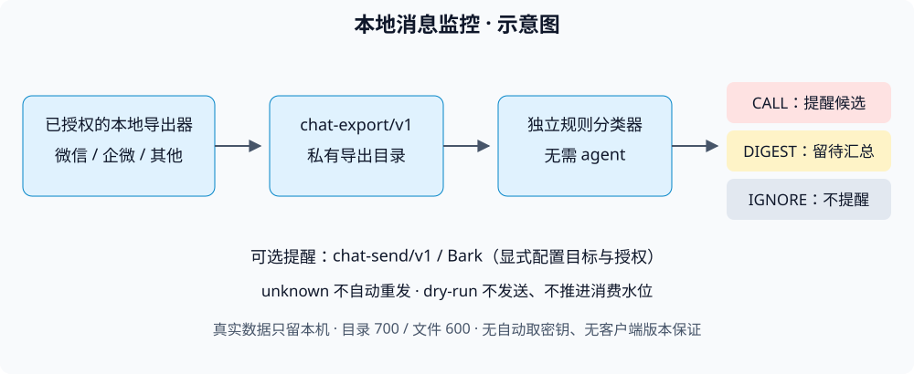

# 微信 / 企业微信本地消息监控

**5 分钟可跑离线合成数据演示；真实部署难度高，两者不是一回事。** 离线演示不需要客户端、密钥、真实聊天或 agent；真实采集需要你自己的已授权设备、本地数据库、对应密钥和可用的客户端适配，不能保证一次安装即用。

版本 **0.1.0**，MIT。目标是把本地消息确定性分为 **CALL / DIGEST / IGNORE**，不是替你回复消息的机器人。

## 先跑离线演示

在仓库根目录执行（需要 Python 3）：

~~~sh
umask 077
python3 bin/wechat-wecom-monitor demo --output ./demo-output
python3 bin/wechat-wecom-monitor doctor
python3 bin/wechat-wecom-monitor check --export-root ./demo-output/wechat --dry-run
python3 bin/wechat-wecom-monitor check --export-root ./demo-output/wecom --dry-run
~~~

演示只生成合成数据，不运行真实采集或网络请求。指定 --output 后分别保留 wechat/manifest.json 与 wecom/manifest.json，两个平台是独立导出源；不指定 --output 的 demo 默认不保留临时文件。先阅读 [快速开始](docs/QUICKSTART.md)，确认配置与演示导出目录一致，再接入真实数据。dry-run 不发送，也不推进消费水位。

## 生产运行方式：每 10 分钟扫描一次新消息并推送重要消息

```text
┌────────────────────────┐   每 10 分钟 (*/10)       ┌──────────────────────────────┐
│ wechat/ 或 chat-export │ ─────────────────────────▶│ 模式 A：定时智能体（Agent）   │
│ wechat_hourly_check.py │  增量输出新增群聊/私聊     │ 按 monitor-manual-TEMPLATE   │
│ (含 PDF/DOCX/XLSX 解析) │  及附件解析 JSON          │ 语义判定 CALL/DIGEST 后推送   │
└────────────────────────┘                           ├──────────────────────────────┤
┌────────────────────────┐   events --after <id>     │ 模式 B：内置独立规则分类器    │
│ wecom/collector/       │ ─────────────────────────▶│ monitor_engine / classify()  │
│ wecom_hourly_check.py  │  每 10 分钟增量拉取企微    │ 脱离 Agent 直接判定并推送     │
└────────────────────────┘                           └──────────────────────────────┘
```

本项目支持两种 **每 10 分钟增量巡检（`*/10 * * * *`）** 的运行模式：

1. **定时智能体巡检模式（作者当前生产配置）**：
   - 由远端或本机定时智能体（Scheduled Agent）**每 10 分钟**触发一次扫描，调用 `wechat/wechat_hourly_check.py --since <epoch> --lookback 7200` 与 `wecom/wecom_hourly_check.py`（或直接对 `chat-export/v1` 运行 `bin/wechat-wecom-monitor check`），拉取过去窗口内新增的群聊、私聊及解析出的文档附件正文。
   - 智能体结合 [`docs/monitor-manual-TEMPLATE.md`](docs/monitor-manual-TEMPLATE.md)（定义了 `P0 / P1 / P2 / IGNORE` 四级群聊、关键联系人、权威发言人及语境规则）对新消息做上下文判断，筛选出真正需要打断本人的 **`CALL`**（立即强提醒）与 **`DIGEST`**（重要消息摘要），通过 Bark 或 `chat-send/v1` 推送重要消息，其余日常闲聊全部归入 `IGNORE`。
2. **纯规则脱离 Agent 独立模式**：
   - 不使用智能体时，可直接由系统 `cron` / `systemd timer` **每 10 分钟**运行内置的独立规则分类器（`monitor_engine.py` 的 `classify_message()`、`wechat_hourly_check.py --classify` 或 `wecom_hourly_check.py` 的 `classify()`）：

~~~python
from monitor_engine import classify_message, load_config
config = load_config()
result = classify_message(message, conversation, config)
# {"action": "CALL" | "DIGEST" | "IGNORE", "reason": "..."}
~~~

规则详见 [配置说明](docs/CONFIGURATION.md) 与 [`docs/monitor-config-TEMPLATE.json`](docs/monitor-config-TEMPLATE.json)。默认私聊归为 `DIGEST`、`@自己` 归为 `CALL`；本人发出的消息和 `IGNORE` 级群聊自动忽略。
## 五仓库组合

| 仓库 | 职责 | 连接方式 |
|---|---|---|
| wechat-export-send | 微信导出、发送适配 | 产出 chat-export/v1；提供 chat-send/v1 |
| wecom-export | 企微本地采集、导出 | 产出 chat-export/v1 |
| server-autoops | Linux 任务、健康巡检与告警接入 | 运维侧接入监控与告警；不是消息导出器 |
| chat-digest | 摘要、报告 | 消费 chat-export/v1，可调用 chat-send/v1 |
| wechat-wecom-monitor（本仓库） | 增量检查、规则分类、提醒 | 消费 chat-export/v1，可调用 chat-send/v1 或 Bark |

仓库通过目录和命令协作，不要求运行在同一个进程。server-autoops 是 Linux 任务、健康巡检与告警接入方，不是数据导出器；此处不约定其具体 CLI。完整导出与发送接口见 [CONTRACT](docs/CONTRACT.md)。



## 文档导航

- [安装与定时运行](docs/INSTALL.md)
- [配置字段与默认规则](docs/CONFIGURATION.md)
- [架构与边界](docs/ARCHITECTURE.md)
- [兼容性](docs/COMPATIBILITY.md)
- [排障](docs/TROUBLESHOOTING.md)
- [验收清单](docs/VALIDATION.md)
- [人工复核手册模板](docs/monitor-manual-TEMPLATE.md)
- [机器配置模板](docs/monitor-config-TEMPLATE.json)

## 隐私与限制

只处理你有权访问的账号、设备和数据。源库只读不等于无隐私风险：导出、附件、状态、日志、截图和提醒都可能泄露聊天。私有目录权限 700，配置、密钥、状态文件权限 600；禁止上传真实数据、密钥或带身份信息的日志到仓库、Issue 或公共模型。Bark 与发送命令是显式外发通道，启用前核对接收人及内容。

不保证任何客户端版本可用，不自动获取密钥，不提供绕过授权的流程。unknown 发送结果绝不自动重发，必须人工确认。不会代替用户回复、接龙、付款或操作账号。历史 wechat/、wecom/、digest-bot/ 是本地采集与摘要参考组件，不应把其中环境假设当成通用安装保证。
