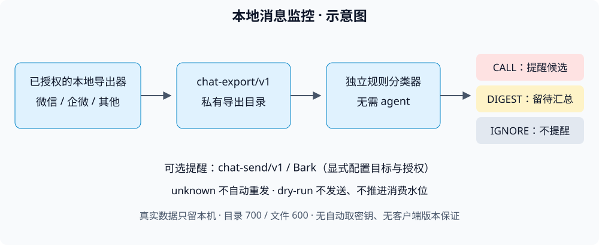

# 架构说明

## 主路径（每 10 分钟增量巡检）

1. **数据源（双轨支持）**：
   - **统一契约轨**：`wechat-export-send`、`wecom-export` 持续产出 `chat-export/v1` 目录；本工具读取 `manifest.json` 和会话 JSONL，自行维护消费水位。
   - **原生直读轨**：由定时任务或智能体（Agent）**每 10 分钟**调用 `wechat/wechat_hourly_check.py`（只读解密微信本地库、合并主小号去重、提取 PDF/DOCX/XLSX/TXT 附件正文）与 `wecom/wecom_hourly_check.py`（SSH 拉取 Windows 企微采集器增量事件）。
2. **分级判定（双模式支持）**：
   - **智能体（Agent）按手册判定模式（生产实测配置）**：定时智能体每 10 分钟读取新增消息 JSON，对照 `docs/monitor-manual-TEMPLATE.md` 的群分级（`P0/P1/P2/IGNORE`）、关键人名单与语境规则判定 `CALL / DIGEST / IGNORE` 并推送重要消息。
   - **内置独立规则模式（无需 Agent）**：`monitor_engine.py` 的 `classify_message(message, conversation, config)` 按 `docs/monitor-config-TEMPLATE.json` 确定性输出 `action` 与 `reason`。
3. **推送与水位更新**：`CALL` 作为立即强提醒候选，`DIGEST` 作为重要消息摘要推送或留给汇总消费者，`IGNORE` 不打扰；可选 `chat-send/v1` 或 Bark 外发必须显式配置。每次完成后推进消费水位（`dry-run` 不推进水位）。
## 组件边界

| 组件 | 职责 |
|---|---|
| bin/wechat-wecom-monitor | demo / doctor / check CLI |
| monitor_engine.py | 配置、规则分类、统一导出检查与提醒协调 |
| wechat/ | 微信本地库只读采集参考与独立分类接入 |
| wecom/collector/ | Windows 企微本地采集与导出 |
| wecom/wecom_hourly_check.py | 企微检查入口与分类接入 |
| digest-bot/ | 可选摘要与报告参考，不是核心分类器的必需依赖 |

## 失败边界

发送结果遵守 CONTRACT：sent 才是确认成功；failed 是确定提交前失败；unknown 是可能已提交，绝不自动重发；invalid 要修配置。dry_run 不是已发送。外发不能保证跨进程、跨服务的 exactly-once，不应在人工确认前清空状态重跑。

本地数据库读取和统一导出消费是两个阶段。未落盘、未同步或未知结构的消息不能凭空恢复；缺失媒体不得伪装成完整原图。规则匹配也不替代人工理解消息与风险。

## 隐私边界

真实导出、密钥、配置、账号 ID、媒体、状态和日志都留在本机私有目录，目录 700、文件 600。仓库只接受合成示例；不上传真实数据做诊断。只读源库不意味着允许把消息发送给第三方。发送通道独立授权，禁止代回复或自动付款。
